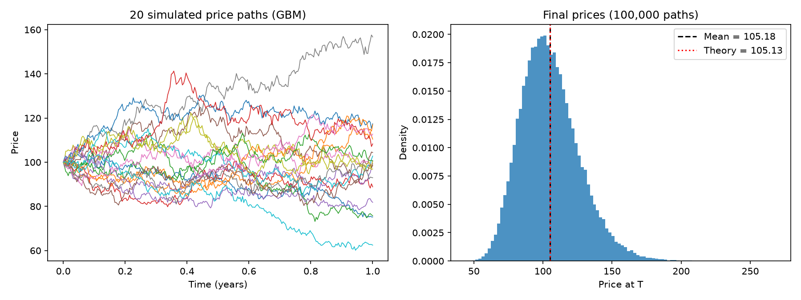
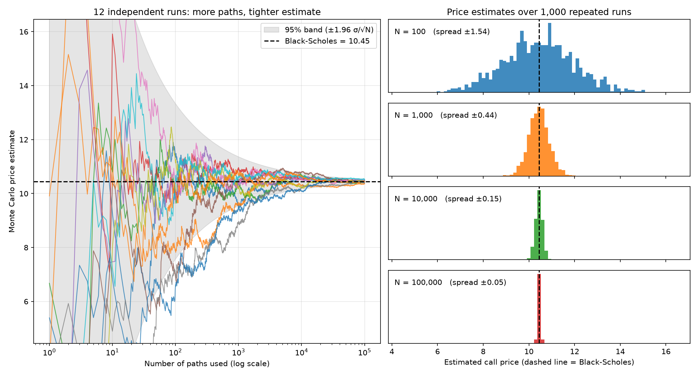
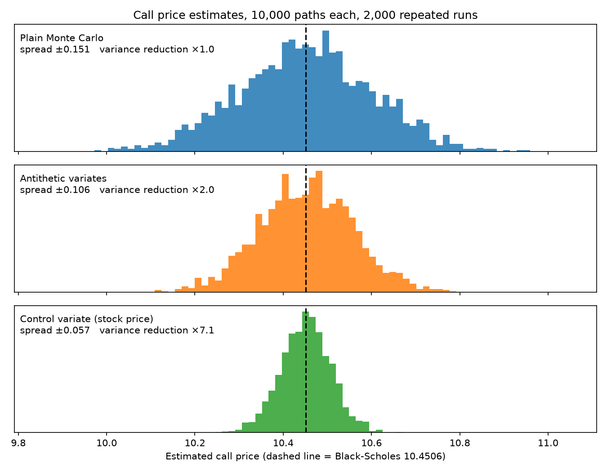

# Monte Carlo Simulation Engine

A from-scratch Monte Carlo engine in Python (NumPy), built to simulate stock price
paths under Geometric Brownian Motion and, next, to price derivatives with
quantified error. Every result is checked against a known analytical answer.

## Model

Prices follow Geometric Brownian Motion:

$$dS_t = \mu S_t\,dt + \sigma S_t\,dW_t$$

Instead of an Euler approximation, the simulator uses the exact solution of the SDE,
so there is no discretisation error:

$$S_{t+\Delta t} = S_t \exp\!\Big(\big(\mu - \tfrac{1}{2}\sigma^2\big)\Delta t + \sigma\sqrt{\Delta t}\,Z\Big), \qquad Z \sim \mathcal{N}(0,1)$$

The `-σ²/2` term (Itô correction) keeps the expected price equal to `S0 · e^{μT}`.
All paths are generated in one vectorised NumPy operation (no Python loops).

## Results



With `S0 = 100`, `μ = 5%`, `σ = 20%`, `T = 1 year`, 252 steps and 100,000 paths,
the simulated mean final price is close to the theoretical `100 · e^{0.05} ≈ 105.13`
(see the legend of the right-hand plot). The distribution of final prices is
log-normal, as expected.

### European call pricing

Monte Carlo price vs the exact Black-Scholes price (`S0=K=100`, `r=5%`, `σ=20%`, `T=1`):

| Method | Price |
|---|---|
| Black-Scholes | 10.4506 |
| Monte Carlo (200,000 paths) | 10.3993 ± 0.0328 (95% CI: [10.335, 10.464]) |

The standard error shrinks as 1/√N: 100× more paths buys only 10× more precision.



### Variance reduction

Same number of paths (10,000), 2,000 independent runs per method:

| Method | Spread of the estimate | Variance reduction |
|---|---|---|
| Plain Monte Carlo | ±0.151 | ×1 |
| Antithetic variates | ±0.106 | ×2 |
| Control variate (discounted stock price, E = S0) | ±0.057 | ×7 |

The control variate gives the precision of plain Monte Carlo with ~7× more paths.
The optimal coefficient β = Cov(Y, X) / Var(X) is the slope of a regression of the
payoff on the stock price, close to the option's delta.



### Arithmetic Asian call (no closed form)

Payoff on the average of 52 weekly prices: `max(mean(S_1..S_52) − K, 0)`.
There is no closed form for the arithmetic average, but the geometric average is
log-normal and has an exact price, so it is used as a control variate.

| | Price | Std. error (100,000 paths) |
|---|---|---|
| European call (Black-Scholes) | 10.4506 | exact |
| Geometric Asian call (closed form) | 5.6374 | exact |
| Arithmetic Asian, plain MC | 5.869 | 0.0256 |
| Arithmetic Asian, geometric control variate | 5.8543 | 0.0007 |

Variance reduction ≈ ×1,300: the same precision as plain Monte Carlo with over
1,000× more paths. Validation: the geometric formula is checked against simulation
and reduces to Black-Scholes with one fixing; both estimators agree; and
geometric < arithmetic < European, as theory requires.

## Validation

Tests (`pytest`) check the simulator against closed-form results:

- output shape and starting value,
- reproducibility with a fixed seed,
- mean of final prices vs `S0 · e^{μT}`, within 3 standard errors,
- mean and standard deviation of log-returns vs `(μ − σ²/2)T` and `σ√T`.

## Project structure

```
mcsim/paths.py        GBM path simulator
tests/test_paths.py   statistical tests
plot_paths.py         generates figures/gbm_paths.png
figures/              output plots
```

## Quickstart

```bash
git clone https://github.com/<andreaaa-jama>/monte-carlo-sim.git
cd monte-carlo-sim
python3 -m venv .venv
source .venv/bin/activate
pip install -r requirements.txt

python -m pytest -v        # run the tests
python plot_paths.py       # regenerate the figure
```

```python
from mcsim.paths import simulate_gbm

paths = simulate_gbm(S0=100, mu=0.05, sigma=0.2, T=1, n_steps=252, n_paths=100_000, seed=1)
# shape: (n_paths, n_steps + 1)
```

## Roadmap

- [x] GBM path simulator with statistical tests
- [x] European call/put pricing with standard error and 95% confidence interval, validated against Black-Scholes
- [x] Convergence study (error vs number of paths, 1/√N)
- [x] Variance reduction: antithetic variates, control variates
- [ ] Path-dependent options (Asian, barrier)
- [ ] Greeks with common random numbers